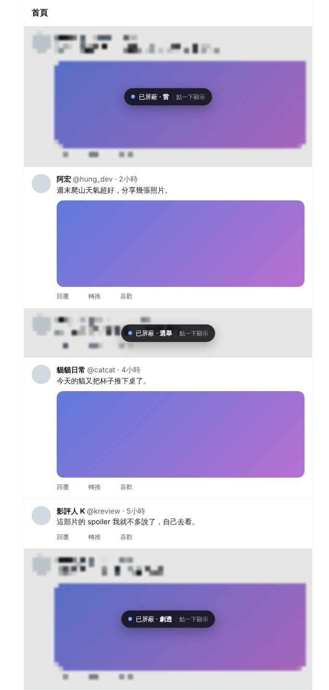

# 靜音牆 QuietWall

用自訂關鍵字屏蔽社群網站上不想看到的貼文與影片。
命中的內容會被模糊、馬賽克或塗黑，點一下才會顯示原文。



---

## 功能

- **自訂關鍵字**：支援「包含文字」「完整單字」「正規表示式」三種比對模式。
- **四種遮蔽效果 + 完全隱藏**：模糊、馬賽克、黑條、收合、隱藏，強度可調。
- **點一下看原文**：也可改成滑鼠移過去顯示，或鎖死不給看。
- **例外關鍵字**：優先於所有規則，用來處理誤殺（例如屏蔽「蘋果」但想看「蘋果派」）。
- **逐站設定**：每條規則都能指定只在某些網站生效；每個網站也能整個關掉。
- **規避防護**：自動正規化全形字與零寬字元，`選​舉`、`ＳＰＯＩＬＥＲ` 一樣會被攔下。
- **右鍵快速新增**：在頁面上選取文字，右鍵即可加入屏蔽清單。
- **備份還原**：設定可匯出成 JSON 檔，換電腦直接匯入。

## 支援網站

| 網站 | 狀態 | 涵蓋範圍 |
|---|---|---|
| Facebook | ✅ 第一階段 | 動態消息貼文、貼文底下的留言 |
| Instagram | ✅ 第一階段 | 主頁貼文、探索／個人檔案的縮圖格 |
| Threads | ✅ 第一階段 | 串文列表 |
| X / Twitter | ✅ 第一階段 | 時間軸推文（含轉推、引用） |
| Pornhub | ✅ 第一階段 | 影片列表、推薦區塊、播放頁（依標題與標籤判斷） |

後續階段可再加入 YouTube、Reddit、Dcard、PTT 等，只需在 `src/content/adapters.js`
增加一組設定，比對與遮罩邏輯都不必改動。

## 安裝

目前以「未封裝擴充功能」方式安裝：

```bash
git clone <本專案> quietwall
```

1. 開啟 Chrome，網址列輸入 `chrome://extensions`
2. 右上角開啟「開發人員模式」
3. 點「載入未封裝項目」，選擇 `quietwall` 這個資料夾
4. 安裝後會自動開啟設定頁，先加幾個關鍵字即可開始使用

## 使用方式

### 快速上手
點工具列上的圖示 → 在「快速加入屏蔽關鍵字」輸入字詞 → 按「加入」。
圖示上的數字代表目前這個分頁被屏蔽了幾則。

### 比對模式怎麼選

| 模式 | 說明 | 適合 |
|---|---|---|
| 包含文字 | 內文出現這段字就屏蔽 | 中文詞彙，例如「劇透」「選舉」 |
| 完整單字 | 英數需完整符合，`spoiler` 不會命中 `spoilers` | 英文短字、縮寫，例如 `AI`、`NBA` |
| 正規表示式 | 進階樣式比對，例如 `(第\d+集|最終回).*雷` | 需要組合條件時 |

中日韓文字在「完整單字」模式下視為邊界，所以 `AI` 會命中「繪圖AI很強」，
但不會命中 `SAID`。

### 比對的範圍
除了貼文內文，也會一併比對作者名稱、`alt` 圖說、`aria-label`、連結標題。
Pornhub 另外會把影片網址納入比對。

## 技術架構

```
manifest.json              MV3 設定
src/common/defaults.js     設定結構、預設值、驗證與正規化（四個環境共用）
src/content/
  matcher.js               關鍵字編譯與比對（NFKC 正規化、零寬字元處理）
  adapters.js              各網站的選擇器與取字規則 ← 要加新網站只改這裡
  masker.js                套用／移除遮罩、覆蓋層互動、SVG 馬賽克濾鏡
  scanner.js               MutationObserver + 去抖動 + 定期補掃
  main.js                  進入點，串起設定、比對、掃描
  mask.css                 遮罩樣式
src/background/            徽章計數、右鍵選單
src/popup/  src/options/   使用者介面
```

幾個設計上的取捨：

- **不改動網站的 DOM 結構**。遮罩效果是靠 CSS 選擇器
  `.pb-host > *:not(.pb-ui)` 套在子元素上，只額外塞一層覆蓋層進去。
  這樣 React 重新渲染時效果不會掉，也不會因為包了一層 wrapper 而弄壞版面。
- **馬賽克是真的像素化**，用 SVG `feTile` 濾鏡做，不是模糊加格線。
- **巢狀去重**。Facebook 的留言和貼文都是 `div[role="article"]`，
  掃描時由外而內處理，外層貼文被遮住後內層就不再重複疊一層。
- **效能**：DOM 變動以 180ms 去抖動合併，大量節點時改為整頁掃描，
  並用 `requestIdleCallback` 在瀏覽器空閒時執行。

## 已知限制

- 「完全隱藏」的貼文無法在頁面上點開，確定不想看再用。
- 社群網站改版後 CSS 選擇器可能失效，屆時需更新 `adapters.js`。
- 模糊／馬賽克下的文字仍存在於 DOM 中，只是看不見；
  真的完全不想載入請用「完全隱藏」。
- 目前只在這五個網站上執行，不會對其他網頁要求任何權限。

## 開發

程式碼沒有建置流程，改完直接在 `chrome://extensions` 按重新載入即可。

語法檢查：

```bash
for f in src/common/*.js src/content/*.js src/popup/*.js src/options/*.js; do node --check "$f"; done
```

## 隱私

所有設定只存在瀏覽器本機（`chrome.storage.local`），不會上傳到任何地方，
擴充功能也沒有任何對外連線。
